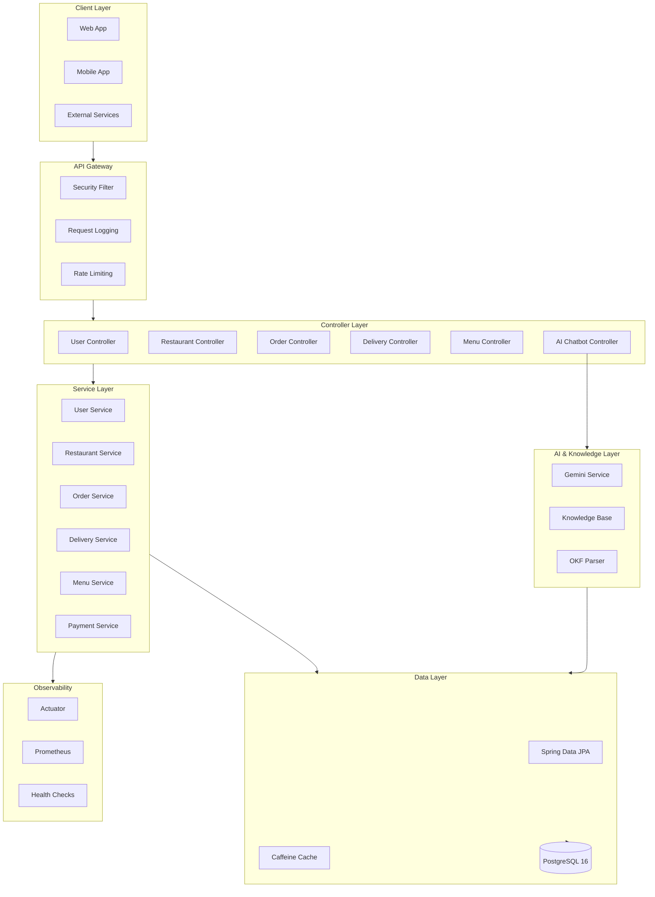
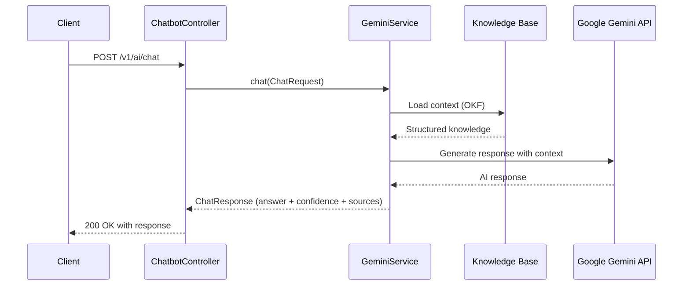
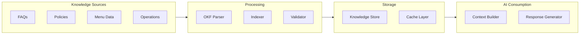
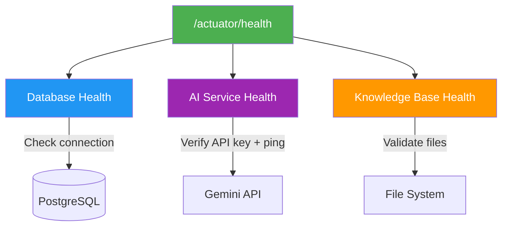
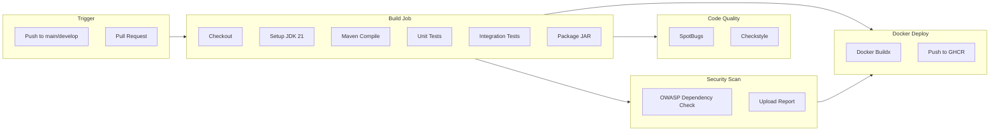
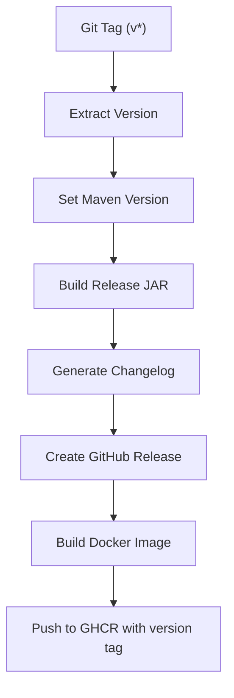
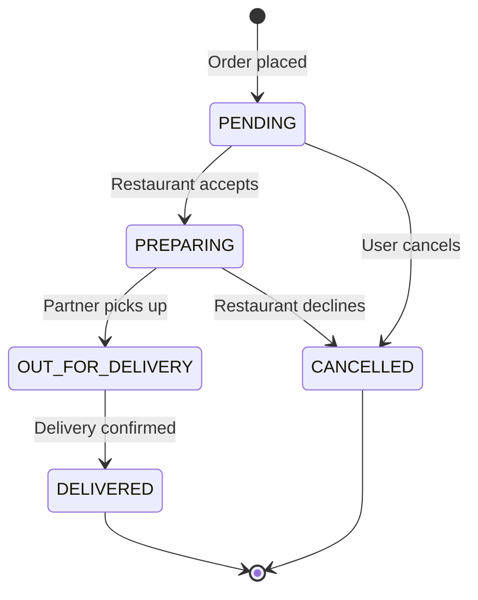
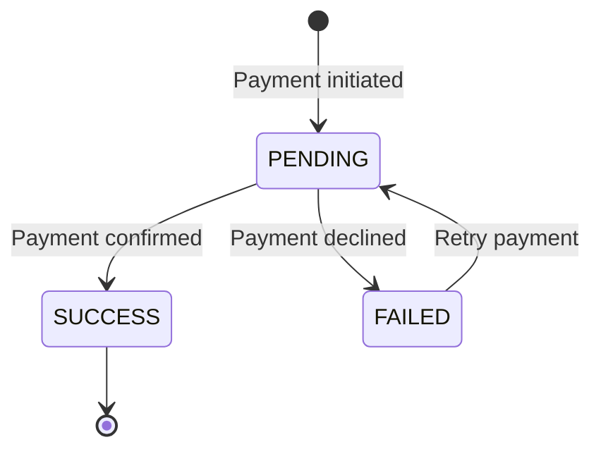
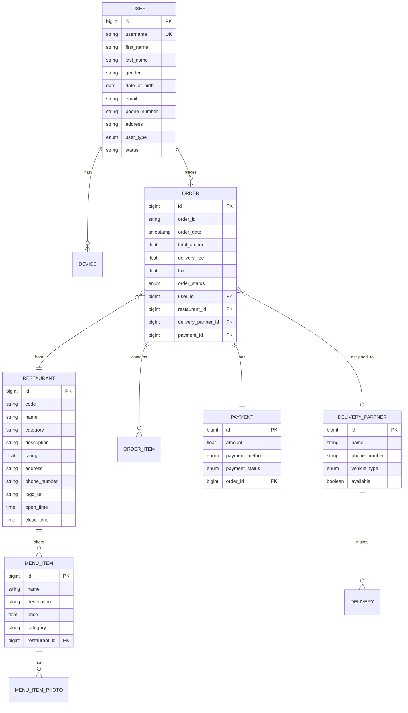

# Food Delivery API - AI-Powered Platform

> An enterprise-grade, AI-enhanced food delivery backend API built with Java 21, Spring Boot 3.3, and Google Gemini AI integration. Features a knowledge-driven chatbot, Open Knowledge Format (OKF) knowledge base, and production-ready CI/CD pipeline.


---

## Table of Contents

- [Architecture Overview](#architecture-overview)
- [Key Features](#key-features)
- [Tech Stack](#tech-stack)
- [Getting Started](#getting-started)
- [API Documentation](#api-documentation)
- [AI Capabilities](#ai-capabilities)
- [Knowledge Base (OKF)](#knowledge-base-okf)
- [Monitoring & Observability](#monitoring--observability)
- [CI/CD Pipeline](#cicd-pipeline)
- [Project Structure](#project-structure)
- [Contributing](#contributing)
- [License](#license)

---

## Architecture Overview



---

## Key Features

### Core Business Features

| Feature | Description |
|---------|-------------|
| **Order Management** | Complete order lifecycle with real-time status tracking (PENDING -> PREPARING -> OUT_FOR_DELIVERY -> DELIVERED) |
| **Restaurant Management** | CRUD operations with menu, photo management, hours, and category support |
| **Delivery Partner System** | Partner registration, availability tracking, and delivery assignment |
| **Payment Processing** | Multi-method payments (Cash, KhQR) with status workflow |
| **User Management** | Profile management, device tracking, and multi-role support |
| **Menu Item Photos** | Multipart file upload with extension validation and size limits |

### AI & Intelligence Features

| Feature | Description |
|---------|-------------|
| **AI Chatbot** | Gemini 2.0 Flash powered conversational AI for customer support |
| **Knowledge Base** | Open Knowledge Format (OKF) structured data for contextual answers |
| **Intelligent Search** | Context-aware query resolution with confidence scoring |
| **Source References** | Transparent AI with traceable answer provenance |

### Production Features

| Feature | Description |
|---------|-------------|
| **Metrics & Monitoring** | Micrometer + Prometheus integration with custom business metrics |
| **Health Checks** | Database, AI service, and knowledge base health monitoring |
| **Structured Logging** | JSON logging with request correlation and timing |
| **Security** | Spring Security with JWT authentication and input validation |
| **CI/CD** | Automated testing, security scanning, and Docker deployment |
| **Caching** | Caffeine in-memory cache for performance optimization |

---

## Tech Stack

| Category | Technology | Version |
|----------|-----------|---------|
| **Language** | Java (Temurin) | 21 |
| **Framework** | Spring Boot | 3.3.5 |
| **Database** | PostgreSQL | 16 |
| **ORM** | Hibernate / Spring Data JPA | 6.x |
| **AI** | Google Gemini | 2.0 Flash |
| **Cache** | Caffeine | Latest |
| **Security** | Spring Security + JWT (jjwt) | 0.12.6 |
| **API Docs** | SpringDoc OpenAPI | 2.6.0 |
| **Metrics** | Micrometer + Prometheus | Latest |
| **Build** | Maven | 3.9+ |
| **CI/CD** | GitHub Actions | v4 |
| **Container** | Docker + GHCR | Latest |
| **Reactive** | Spring WebFlux (WebClient) | 6.x |
| **Mapping** | ModelMapper | 3.2.1 |

---

## Getting Started

### Prerequisites

- Java 21+ (Temurin recommended)
- Maven 3.9+
- PostgreSQL 16+
- Google Gemini API Key

### Quick Start with Docker Compose

```yaml
# docker-compose.yml
services:
  postgres:
    image: postgres:16-alpine
    environment:
      POSTGRES_DB: food_delivery
      POSTGRES_USER: food_delivery_user
      POSTGRES_PASSWORD: ${DB_PASSWORD}
    ports:
      - "5432:5432"
    volumes:
      - pgdata:/var/lib/postgresql/data

  app:
    build: ./food-delivery-api-main
    ports:
      - "8080:8080"
    environment:
      SPRING_PROFILES_ACTIVE: dev
      DB_URL: jdbc:postgresql://postgres:5432/food_delivery
      DB_USERNAME: food_delivery_user
      DB_PASSWORD: ${DB_PASSWORD}
      GEMINI_API_KEY: ${GEMINI_API_KEY}
    depends_on:
      postgres:
        condition: service_healthy

volumes:
  pgdata:
```

```bash
docker compose up -d
```

### Manual Setup

```bash
# Clone the repository
git clone https://github.com/your-org/Food-Delivery-API.git
cd Food-Delivery-API/food-delivery-api-main

# Configure environment
export DB_URL=jdbc:postgresql://localhost:5432/food_delivery
export DB_USERNAME=food_delivery_user
export DB_PASSWORD=your_secure_password
export GEMINI_API_KEY=your_gemini_api_key

# Build and run
mvn clean package -DskipTests
java -jar target/food-delivery-api-0.0.1-SNAPSHOT.jar
```

### Environment Variables

| Variable | Description | Default |
|----------|-------------|---------|
| `SPRING_PROFILES_ACTIVE` | Active Spring profile | `dev` |
| `SERVER_PORT` | Application port | `8080` |
| `DB_URL` | PostgreSQL JDBC URL | `jdbc:postgresql://localhost:5432/food_delivery` |
| `DB_USERNAME` | Database username | `food_delivery_user` |
| `DB_PASSWORD` | Database password | *Required* |
| `GEMINI_API_KEY` | Google Gemini API key | *Required* |
| `UPLOAD_DIR` | File upload directory | `./uploads` |

---

## API Documentation

Interactive API documentation is available at runtime:

- **Swagger UI**: `http://localhost:8080/swagger-ui.html`
- **OpenAPI JSON**: `http://localhost:8080/api-docs`

### Endpoints Overview

| Domain | Method | Endpoint | Description |
|--------|--------|----------|-------------|
| **Users** | POST | `/v1/users` | Create user |
| | PUT | `/v1/users/{id}` | Update user |
| | GET | `/v1/users/{id}` | Get user by ID |
| | GET | `/v1/users` | List all users |
| | DELETE | `/v1/users/{id}` | Delete user |
| **Restaurants** | POST | `/v1/restaurants` | Create restaurant |
| | PUT | `/v1/restaurants/{id}` | Update restaurant |
| | GET | `/v1/restaurants/{id}` | Get restaurant by ID |
| | GET | `/v1/restaurants` | List all restaurants |
| | DELETE | `/v1/restaurants/{id}` | Delete restaurant |
| **Orders** | POST | `/v1/orders` | Place order |
| | PUT | `/v1/orders` | Update order status |
| **Menu Items** | POST | `/v1/menu-item` | Create menu item |
| | PUT | `/v1/menu-item/{id}` | Update menu item |
| | GET | `/v1/menu-item/{id}` | Get menu item |
| | GET | `/v1/menu-item` | List all menu items |
| | DELETE | `/v1/menu-item/{id}` | Delete menu item |
| **Photos** | POST | `/v1/menu-item/photo/upload` | Upload photos |
| | PUT | `/v1/menu-item/photo/{id}` | Update photo metadata |
| | GET | `/v1/menu-item/photo/{id}` | Get photo by ID |
| | GET | `/v1/menu-item/photo` | List all photos |
| | DELETE | `/v1/menu-item/photo/{id}` | Delete photo |
| **Delivery** | POST | `/v1/delivery-partner` | Register partner |
| | PUT | `/v1/delivery-partner/{id}` | Update partner |
| | GET | `/v1/delivery-partner/{id}` | Get partner |
| | GET | `/v1/delivery-partner` | List partners |
| | DELETE | `/v1/delivery-partner/{id}` | Remove partner |
| **AI Chat** | POST | `/v1/ai/chat` | AI conversation |
| | GET | `/v1/ai/health` | AI service health |

> For detailed request/response schemas, see [API_DOCUMENTATION.md](./food-delivery-api-main/API_DOCUMENTATION.md)

---

## AI Capabilities

### Chatbot Architecture



### Chat Request/Response

**Request:**
```json
{
  "message": "What are the delivery hours?",
  "conversation_id": "conv_abc123",
  "include_context": true
}
```

**Response:**
```json
{
  "answer": "Our delivery partners operate from 8 AM to 11 PM daily...",
  "conversation_id": "conv_abc123",
  "source_references": ["knowledge/delivery-policy.okf"],
  "confidence": 0.94,
  "response_time_ms": 342,
  "timestamp": "2024-01-15T10:30:00Z"
}
```

### Capabilities

- **Chat** - Natural language conversation about food delivery topics
- **Knowledge Query** - Answers grounded in structured OKF knowledge base
- **API Help** - Guidance on using the food delivery platform

---

## Knowledge Base (OKF)

The Open Knowledge Format (OKF) provides structured knowledge that the AI uses for contextual, accurate responses.



### OKF Structure

Knowledge is organized into domains with metadata, making it easy for the AI to find relevant context:

```
knowledge/
  delivery-policy.okf     # Delivery rules and hours
  payment-methods.okf     # Supported payment information
  restaurant-faq.okf      # Common restaurant questions
  order-process.okf       # Order lifecycle documentation
```

---

## Monitoring & Observability

### Health Endpoints

| Endpoint | Description |
|----------|-------------|
| `/actuator/health` | Composite health (DB + AI + Knowledge Base) |
| `/actuator/info` | Application info and version |
| `/actuator/metrics` | All application metrics |
| `/actuator/prometheus` | Prometheus-compatible metrics export |

### Custom Health Indicators



### Business Metrics

| Metric | Type | Description |
|--------|------|-------------|
| `api.ai.chat` | Timer | AI chat endpoint response time |
| `http.server.requests` | Timer | All HTTP request durations |
| `jvm.memory.used` | Gauge | JVM memory utilization |
| `hikaricp.connections.active` | Gauge | Active database connections |
| `cache.gets` | Counter | Cache hit/miss ratio |

### Structured Logging

Requests are logged with correlation and timing via the `RequestLoggingFilter`:

```
2024-01-15 10:30:00.123 [http-nio-8080-exec-1] INFO  c.c.filter.RequestLoggingFilter - POST /v1/orders 200 45ms
```

---

## CI/CD Pipeline

### Continuous Integration



### Release Pipeline



### Pipeline Features

- **PostgreSQL 16** service container for integration tests
- **Maven caching** for faster builds
- **Test reporting** via dorny/test-reporter
- **SpotBugs + Checkstyle** code quality gates
- **OWASP Dependency Check** for vulnerability scanning
- **Multi-tag Docker builds** (latest + SHA + version)
- **Automated GitHub Releases** with changelogs

---

## Order Lifecycle



### Payment State Machine



---

## Database Schema



---

## Project Structure

```
Food-Delivery-API/
├── .github/
│   └── workflows/
│       ├── ci.yml                    # CI pipeline (build, test, scan, docker)
│       └── release.yml               # Release pipeline (tag-based)
├── food-delivery-api-main/
│   ├── src/main/java/com/codestorykh/
│   │   ├── FoodDeliveryApiApplication.java
│   │   ├── ai/
│   │   │   ├── controller/           # AI chatbot endpoints
│   │   │   ├── model/                # Chat request/response DTOs
│   │   │   └── service/              # Gemini AI integration
│   │   ├── config/
│   │   │   ├── CacheConfig.java      # Caffeine cache configuration
│   │   │   ├── MetricsConfig.java    # Micrometer metrics setup
│   │   │   ├── WebClientConfig.java  # Reactive HTTP client
│   │   │   └── WebMvcConfig.java     # MVC configuration
│   │   ├── constant/                 # Application constants
│   │   ├── controller/               # REST API controllers
│   │   ├── dto/                      # Request/Response DTOs
│   │   ├── enumeration/              # Business enums (OrderStatus, PaymentMethod, etc.)
│   │   ├── exception/                # Global exception handling
│   │   ├── filter/                   # HTTP filters (logging, security)
│   │   ├── health/                   # Custom health indicators
│   │   ├── model/                    # JPA entities
│   │   ├── repository/               # Spring Data repositories
│   │   ├── service/                  # Business logic layer
│   │   │   ├── handler/              # Strategy pattern handlers
│   │   │   └── impl/                 # Service implementations
│   │   └── utils/                    # Utility classes
│   ├── src/main/resources/
│   │   ├── application.yml           # Main configuration
│   │   ├── application-dev.yml       # Development profile
│   │   └── logback-spring.xml        # Logging configuration
│   └── pom.xml                       # Maven dependencies
├── API_DOCUMENTATION.md              # Detailed API docs
└── README.md                         # This file
```

---

## Contributing

### Development Workflow

1. **Fork** the repository
2. **Create** a feature branch: `git checkout -b feature/your-feature`
3. **Commit** with conventional commits: `feat:`, `fix:`, `docs:`, `refactor:`
4. **Test** locally: `mvn clean verify`
5. **Push** and create a Pull Request

### Code Standards

- Follow Java 21 coding conventions
- Use Lombok for boilerplate reduction
- Write unit tests for all service methods
- Include integration tests for controllers
- Keep DTOs separate from entities

### Branch Strategy

| Branch | Purpose |
|--------|---------|
| `main` | Production-ready code |
| `develop` | Integration branch |
| `feature/*` | New features |
| `fix/*` | Bug fixes |
| `release/*` | Release preparation |

---

## License

This project is licensed under the MIT License. See the [LICENSE](LICENSE) file for details.

---

<p align="center">
  Built with Java 21 and Spring Boot 3.3.5<br>
  AI powered by Google Gemini 2.0 Flash
</p>
